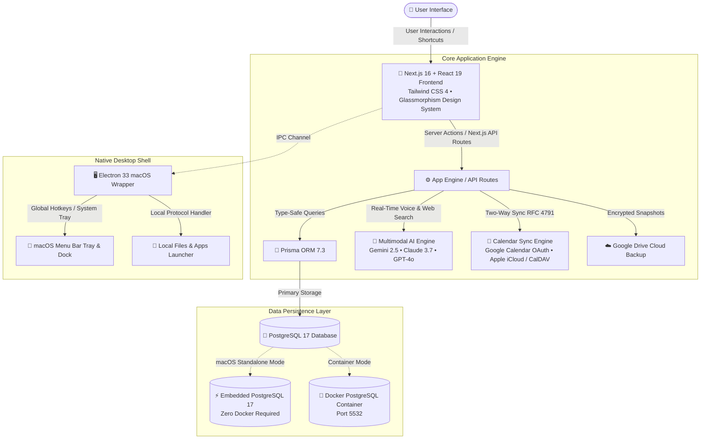

<div align="center">

  <a href="https://1kenz.github.io/dnz-productivity-dashboard/">
    
  </a>

  # DNZ Productivity Dashboard
  ### The All-in-One, Local-First Productivity & Cognition Cockpit

  **Enterprise-grade workstation featuring Task & Project Hierarchies, Interactive Kanban, Unified Multi-Account Calendars, Deep-Work Focus Tools, and a Voice-Driven Multimodal AI Assistant.**

  <br />

  [](https://1kenz.github.io/dnz-productivity-dashboard/)
  [](https://github.com/1kenz/dnz-productivity-dashboard/releases)
  [](LICENSE)

  [](https://nextjs.org/)
  [](https://react.dev/)
  [](https://www.typescriptlang.org/)
  [](https://tailwindcss.com/)
  [](https://www.electronjs.org/)
  [](https://www.postgresql.org/)
  [](docker-compose.yml)

  <br />

  **[🌐 Live Showcase Site](https://1kenz.github.io/dnz-productivity-dashboard/)** • **[⚡ Quickstart](#-quickstart)** • **[✨ Key Features](#-key-features)** • **[🖥️ macOS Desktop App](#%EF%B8%8F-native-macos-desktop-app)** • **[🛠️ Architecture](#%EF%B8%8F-technical-architecture)** • **[🔒 Security & Privacy](#-security--zero-telemetry-guarantee)**

</div>

---

> ### 🌐 **Live Showcase & Interactive Product Tour**
> Experience the interactive live presentation, feature walk-throughs, and architecture diagrams directly in your browser:  
> 👉 **[https://1kenz.github.io/dnz-productivity-dashboard/](https://1kenz.github.io/dnz-productivity-dashboard/)**  
> *(Features built-in instant language switching: **English (Default)**, **Türkçe**, and **Deutsch**).*

---

## 📖 Executive Summary

**DNZ Productivity Dashboard** is an enterprise-grade personal productivity and task orchestration suite engineered for developers, engineering managers, cybersecurity professionals, and power users.

Unlike conventional SaaS productivity tools that lock your sensitive work data into proprietary clouds and harvest it for AI model training, DNZ Productivity Dashboard is built from the ground up with a **strict local-first, zero-telemetry philosophy**. 

Every task, time log, calendar entry, note, and credential stays strictly on your local machine in an ACID-compliant **PostgreSQL** database.

### 🌟 Core Highlights
- **100% Local-First & Sovereign**: Runs on your machine with zero external cloud dependencies.
- **Multimodal AI Assistant & Live Voice**: Real-time voice conversations (VAD + STT + TTS) with live web-search citation support powered by Google Gemini 2.5, Anthropic Claude 3.7, or OpenAI GPT-4o.
- **Native macOS Apple Silicon App**: Standalone `.dmg` packaging an **Embedded PostgreSQL 17** engine, macOS Menu Bar (Tray) icon, and global system hotkeys (`Cmd+K`, `Cmd+J`).
- **Zero-Friction Deployment**: 1-command startup via Docker Compose or native Node.js.

---

## 🏗️ Technical Architecture



---

## ✨ Key Features

### 🤖 Multimodal AI Co-Pilot & Live Voice
- **Multi-Provider Intelligence**: Seamlessly switch between **Google Gemini** (Gemini 2.5 Flash / Pro), **Anthropic Claude** (Claude 3.7 Sonnet), and **OpenAI** (GPT-4o).
- **Real-Time Voice Assistant (Live Voice)**: Hands-free vocal dialogue equipped with Voice Activity Detection (VAD), Whisper STT, and neural Speech Synthesis (TTS).
- **Web-Grounded Research**: Queries web sources in real-time and appends transparent citation footnotes to responses.
- **Executive SITREP**: Generates on-demand daily situational intelligence reports summarizing critical deadlines, overdue items, and schedule conflicts.
- **AI to Action**: Convert any AI response into a task or note with a single click.

### 📋 Task Management & Visual Kanban
- **Interactive Kanban Boards**: Drag-and-drop task workflows across *To Do*, *In Progress*, *Review*, and *Done* states.
- **Priority Scoring**: Low, Medium, and High priority visual badges with color coding.
- **Intelligent Deadlines**: Date filters (*All*, *Today*, *This Week*, *Upcoming*) with daily reminder alerts and warning badges.
- **Recurring Task Automation**: Daily, weekly, monthly, or cron-based schedules with instant pause/resume controls.
- **File Attachments**: Attach local disk files, scripts, documents, and programs directly to tasks.

### 📅 Unified Multi-Account Calendar
- **Bi-Directional Calendar Sync**: Full integration with **Google Calendar** (OAuth 2.0) and **CalDAV** (Apple iCloud, Fastmail, Nextcloud).
- **Built-in Offline Calendar**: Create and manage local events independently of any external calendar account.
- **Optimized Views**: Day, Week, and Month grids calibrated to focused working hours (06:00–18:00).

### ⏱️ Deep Work & Focus Tools
- **Pomodoro Hourglass**: Visual animated hourglass timer with customizable focus and break sessions.
- **Active Time Tracker**: Granular project-based work hour tracking with stopwatches and manual adjustment.
- **Productivity Analytics**: Rich charts powered by **Recharts** visualizing productivity streaks and weekly output.

### 🔗 Smart Quick Links & macOS App Launcher
- **Group Clusters**: Categorized bookmarks with automatic high-resolution favicon scraping.
- **Native App & File Launcher**: Launch native macOS applications (`iTerm`, `VS Code`, `Docker Desktop`), terminal scripts, or folders directly from your browser or app window.
- **Command Palette**: Instant workspace search and navigation via global hotkey <kbd>Cmd</kbd> + <kbd>K</kbd>.

### ☁️ Encrypted Cloud Sync & Data Mobility
- **Google Drive Sync**: Export AES-encrypted database snapshots directly to your personal Google Drive or restore across devices.
- **Zero-Dependency JSON Backups**: 1-click complete database export and instant offline restoration.

---

## 🖥️ Native macOS Desktop App

For macOS users (Sonoma, Sequoia, and Apple Silicon M-Series), DNZ Productivity Dashboard is available as a **native standalone desktop application (`.dmg`)**.

| Feature | Desktop App (.dmg) | Web / Docker Deployment |
| :--- | :---: | :---: |
| **PostgreSQL Database** | **Embedded (Native Bundle)** | Docker Container |
| **Docker Desktop Required** | ❌ **No** | ✅ Yes |
| **macOS Menu Bar (Tray) Icon** | ✅ **Yes** | ❌ No |
| **Global System Hotkeys** (`Cmd+K`, `Cmd+J`) | ✅ **Yes** | In-Browser Only |
| **Native File / App Protocol Launching** | ✅ **Yes** | Local Host Only |
| **Apple Silicon (M1/M2/M3/M4) Optimized** | ✅ **Yes (ARM64)** | Multi-Arch |

### Building the macOS DMG from Source

```bash
# Clone the repository
git clone https://github.com/1kenz/dnz-productivity-dashboard.git
cd dnz-productivity-dashboard

# Build Next.js, bundle Embedded PostgreSQL, and package into .dmg:
bash scripts/build_desktop_app.sh
```
The compiled installer will be generated at `desktop/dist/DNZ Productivity Dashboard-3.0.0-arm64.dmg`.

---

## 🚀 Quickstart

### Option 1: Run via Docker Compose (Recommended)

The easiest and fastest method to launch the web dashboard and PostgreSQL database:

```bash
# 1. Clone the repository
git clone https://github.com/1kenz/dnz-productivity-dashboard.git
cd dnz-productivity-dashboard

# 2. Copy the environment template
cp .env.example .env

# 3. Start the application
docker compose up -d
```
Open **[http://localhost:3000](http://localhost:3000)** (or `http://localhost:9999` for dev compose) in your browser.

---

### Option 2: Local Node.js Development

```bash
# 1. Install dependencies
npm install

# 2. Copy environment template and configure DATABASE_URL
cp .env.example .env

# 3. Push Prisma schema to your PostgreSQL instance
npx prisma db push

# 4. Start Next.js Turbopack development server
npm run dev
```
Open **[http://localhost:3000](http://localhost:3000)** in your browser.

---

## ⚙️ Configuration & Environment Variables

Copy `.env.example` to `.env` and configure your environment:

| Variable | Type | Default | Description |
| :--- | :---: | :---: | :--- |
| `DATABASE_URL` | **Required** | `postgresql://...:5532/...` | PostgreSQL connection string |
| `GOOGLE_CLIENT_ID` | Optional | `""` | Google Cloud OAuth 2.0 Client ID (Drive & Calendar) |
| `GOOGLE_CLIENT_SECRET` | Optional | `""` | Google Cloud OAuth 2.0 Client Secret |
| `GOOGLE_REDIRECT_URI` | Optional | `http://localhost:9999/api/google/callback` | OAuth redirect URI (port `9898` for Desktop) |
| `GEMINI_API_KEY` | Optional | `""` | Google AI Studio Gemini API Key |
| `ANTHROPIC_API_KEY` | Optional | `""` | Anthropic Claude API Key |
| `OPENAI_API_KEY` | Optional | `""` | OpenAI API Key (Whisper STT / TTS / GPT-4o) |

> 💡 *Note: All AI API keys can also be securely configured or updated at runtime directly through the dashboard UI settings (`Settings ➔ AI Configuration`).*

---

## 🔒 Security & Zero-Telemetry Guarantee

1. **Local-First Data Isolation**: All your tasks, notes, time logs, and contacts are stored in your local PostgreSQL database.
2. **Zero Telemetry & Zero Trackers**: No Google Analytics, no Mixpanel, no Sentry, no cookies, and no background crash beacons.
3. **Bring Your Own Keys (BYOK)**: AI models communicate directly with provider APIs using your personal API keys stored in your local database or environment file. Keys are never exposed in frontend bundles or client logs.
4. **Hardened OAuth Scope**: Google Drive and Calendar authorizations use strictly scoped, direct OAuth 2.0 tokens stored locally.

---

## ⌨️ Productivity Keyboard Shortcuts

| Shortcut | Action |
| :--- | :--- |
| <kbd>Cmd</kbd> + <kbd>K</kbd> | Open Command Palette & Quick Search |
| <kbd>Cmd</kbd> + <kbd>J</kbd> | Open Quick Notes Popover |
| <kbd>Esc</kbd> | Dismiss active modal or overlay |
| <kbd>Enter</kbd> | Confirm dialog action / Submit modal |

---

## 🧪 Testing & Code Quality

```bash
# Run unit & integration tests (Jest)
npm test

# Run strict TypeScript type check
npm run type-check

# Run linter (ESLint)
npm run lint

# Run End-to-End tests (Playwright)
npm run test:e2e
```

---

## 🤝 Contributing

Contributions, feature requests, and bug reports are warmly welcomed!

1. Fork the Project (`https://github.com/1kenz/dnz-productivity-dashboard`)
2. Create your Feature Branch (`git checkout -b feature/NewCapability`)
3. Commit your Changes (`git commit -m 'feat: Add NewCapability'`)
4. Push to the Branch (`git push origin feature/NewCapability`)
5. Open a Pull Request

---

## 📄 License

Distributed under the **MIT License**. See `LICENSE` for details.

---

<div align="center">
  <sub>Architected with precision by <strong>DNZ Security & Software</strong> • Maintained by <a href="https://github.com/1kenz">@1kenz</a></sub><br>
  <sub>🌐 <a href="https://1kenz.github.io/dnz-productivity-dashboard/">https://1kenz.github.io/dnz-productivity-dashboard/</a></sub>
</div>
